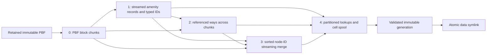

# Architecture and implementation

This is a standalone Fastify service backed by immutable geohash-sharded OSM
amenity generations. It implements a constrained Overpass contract for an
unmodified Overpass-Proxy, with 501 fallback for unsupported QL.
[Operations](OPERATIONS.md) covers deployment; [the specification](../specification.md)
defines the API/storage contract. Historical proposals in `plans/` are not a
description of every current implementation choice.

## Module map

| Module | Responsibility |
|---|---|
| `src/index.ts` | Load configuration, listen, start updater, close HTTP/worker on signals |
| `src/config.ts` | Environment validation, amenity normalization, feed-mode inference |
| `src/server.ts` | HTTP routes, query scope, error responses, monitoring |
| `src/query.ts` | Strict supported QL parser with complete input consumption |
| `src/output.ts` | Overpass JSON/XML serialization and content ETags |
| `src/index/engine.ts` | Pin generation, select/read/cache shards, filter, deduplicate, expand members |
| `src/index/geohash.ts` | Bbox validation and bounded cell enumeration |
| `src/index/shard.ts` | OAM1 writer/reader, typed identity index, CRC and range validation |
| `src/index/apply.ts` | Version/identity and affected-cell helpers |
| `src/replication.ts` | State parsing, escaped timestamps, sequence iteration and URL helpers |
| `src/updater.ts` | Updater subprocess supervision, restart, bounded shutdown |
| `src/logger.ts`, `src/stats.ts` | Structured logs and query/cache metrics |
| `scripts/extract.mjs` | Extraction CLI, source provenance, stage 0, count verification, orchestration |
| `scripts/extract/args.mjs` | CLI scalar/stage parsing |
| `scripts/extract/stages.mjs` | Stages 1–3, fingerprints, manifests, resume and native streams |
| `scripts/extract/worker.mjs` | Separate stage-1 parser/filter worker process |
| `scripts/extract/process.mjs` | Native command pipelines, concurrency, process-tree RSS and cancellation |
| `scripts/extract/xml.mjs`, `lines.mjs` | Streaming XML and intermediate record codec |
| `scripts/extract/storage.mjs` | Partitioned disk lookups, bounded caches, external-sort unique counts |
| `scripts/extract/assembly.mjs` | Stage-4 geometry/helper placement, shard build, guarded activation |
| `scripts/extract/source-index.mjs` | Retained-PBF block ranges and tracked reference/cell indexes |
| `scripts/update.mjs` | One-shot catch-up or watch loop, source attestation and weekly scheduling |
| `scripts/update/replication.mjs` | Namespace-local feed URLs, bounded downloads and gzip streaming |
| `scripts/update/change-parser.mjs` | Action-aware osmChange streaming with validation |
| `scripts/update/change-apply.mjs` | Small streamed change-application helper |
| `scripts/update/delta-store.mjs` | Versioned raw-object overlay and tombstones |
| `scripts/update/object-resolver.mjs` | Resolve current objects from overlay, then retained PBF |
| `scripts/update/apply-generation.mjs` | Ordered batch replay, dependency closure, affected geometry/shard rebuild |
| `scripts/update/generation.mjs` | Kernel lock, copy-on-write staging, durability and atomic activation |
| `scripts/update/reextract.mjs` | Isolated full candidate build, catch-up and weekly publication |
| `scripts/verify-http.mjs` | Live local HTTP contract verifier |
| `scripts/parity.mjs` | Explicit two-endpoint element comparison for a supplied query |
| `scripts/make-fixture.mjs` | Deterministic native extraction fixture |

Build TypeScript first. Extraction/update modules import compiled helpers from
`dist/`; production installs therefore ship both `dist/` and `scripts/`.

## Extraction data flow



Stage 0 copies complete standard PBF frames, each beginning with a four-byte
big-endian BlobHeader length. It adds the source OSMHeader to each chunk, rather
than treating arbitrary byte ranges as independent PBF files.

Stage 1 runs native `osmium cat` and streams XML in an isolated Node process.
It retains all amenity values by default, or only configured values when
requested. Typed member IDs are emitted separately. Stage 2 uses native
`osmium getid` for member ways; references may point into different chunks.
Stage 3 combines sorted unique IDs and streams native OPL nodes through an AWK
merge, then parses selected nodes. This avoids native node-ID bitmap allocation
for modern IDs above 14 billion.

Stages 1–3 produce encoded `.lines` records under their `work/stageN/`
directories. A record begins with `N`, `W`, or `R`, followed by identity and
metadata, type-specific geometry/references, a `-` delimiter, and URI-encoded
tag pairs. Coordinates use integer 1e-7 degrees; relation roles are escaped and
preserve order. Readers reject invalid IDs, coordinates, encodings, and oversized
records. XML parsing is independent of input chunk or line boundaries.

Stage 4 uses partitioned node/way lookups and a disk cell spool. It places nodes
in one point cell and ways/relations in cells intersecting their aggregate bbox.
It adds helper ways/direct member nodes, merges typed spatial duplicates,
checks missing references, and writes one shard at a time. The initial pipeline
does not promise full recursive nested-relation resolution. Ways retain inline
node coordinates; synthesized output nodes need not have original node metadata.

Source/config fingerprints, stage inventories, output hashes, and done-markers
control resume. Incompatible source/config changes invalidate dependent work.
An identical complete generation can be reused after verification; active files
are never used as mutable build outputs.

## On-disk generation and formats

```text
pipeline/
  .generation.lock                 stable flock inode; do not unlink it
  .reextract-schedule.json          first-check timer baseline, when needed
  work/                            chunk/stage manifests, records, temporary diffs
  update-cache/                    source block indexes and source attestations
  data -> data-generations/<id>     active relative symlink
  data-generations/<id>/
    manifest.json                  inventory, config/source fingerprint, counts
    state.json                     data timestamp, source path, namespace cursor
    shards/<geohash>.bin            OAM1 records and indexes
    objects/                       stage-4 partitioned member lookup files
    update-indexes/                 tracked object-to-cell and reverse-parent edges
    delta-objects/                  raw update overlay; created as needed
```

OAM1 current writer version 2 uses a fixed 78-byte little-endian header, string
pool, typed object records, typed `(type,id)` index, and node-reference index.
The current CRC covers header bytes other than the checksum and the payload;
the reader also accepts legacy v1 and early payload-only v2 checksums. The v2
coordinate sentinel is `INT32_MIN`, preserving real `(0,0)` geometry. Legacy v1
zero/zero ambiguity cannot be recovered. Field widths, offsets, index order,
typed references, and safe integer ranges are validated; records too large for
the format are rejected rather than truncated. `src/index/shard.ts` documents
the exact byte layout.

Identity is always `(type,id)`, since the same numeric ID can exist independently
as a node, way, and relation. Config hash inputs are `{ amenities, precision }`.
Counts distinguish unique main objects, unique helpers, duplicate spatial
copies, and total stored records.

## HTTP request path

The parser accepts only the supported amenity-equality/common-bbox grammar and
output clauses, consuming the entire QL input. Unsupported syntax returns 501;
there is no internal remote-query fallback. The proxy owns fallback policy.

Each in-scope query resolves `data/` to one real generation directory, reads
its metadata, and loads only the declared intersecting shards. Missing or
corrupt declared shards and config mismatches fail the query. Undeclared stale
files cannot silently enter the result. The LRU caches buffers by real generation
path and cell, with a byte limit. Invalidating cells scans actual cache entries,
not an unbounded history of previously loaded generations.

The engine filters amenity, bbox and requested object types, deduplicates typed
objects, adds supported members, and serializes JSON/XML. Available `out meta`
fields are at JSON element root or XML element attributes. Stripped metadata
is omitted. The data timestamp comes from source/replication state rather than
the current wall clock. Stable serialized content gives a stable ETag.

## Incremental updates

The updater reads a positive persisted cursor and an exactly matching feed
descriptor `{baseUrl, kind, interval, sequenceNumber}`. Regional/day and
planet/minute cursors remain distinct; sequence 0 is not permission to replay
the entire feed history. URLs use nine digits split into three groups. Regional
URLs use the direct `*-updates` base; planet URLs append `/minute` when needed.

Missing diffs are downloaded in order within count/disk budgets. A batch is
parsed incrementally into a partitioned raw-object overlay. Version guards
compare source and overlay versions; tombstones prevent deleted objects from
reappearing through the baseline. All raw changes are staged before derived
geometry, so references changed later in the same batch are visible during
reconstruction.

Tracked reverse edges determine affected ways/relations when nodes or members
change. Reference resolution batches IDs against the overlay first, then the
retained PBF. The source block index stores compact per-type ID ranges, verifies
monotonic ordering, and selects bounded candidate blocks by binary search.
Native XML filtering avoids high-ID bitmap lookups. Candidate batches split
adaptively to fit byte budgets. Missing required references abort publication.

PBF attestations bind a hash to path/device/inode/size/mtime/ctime. A changed file
identity or alternate mount path requires a hash check against the generation's
source fingerprint. A failed first source-index build cannot cache a mismatched
baseline under the expected fingerprint. Restoring correct bytes permits retry.

The updater rebuilds affected main geometry, preserves shared helpers, prunes
orphan helpers, appends conservative reverse edges and recalculates exact typed
counts with external sorting. Old edges may cause extra work but do not suppress
new dependencies. Source data and cursor metadata advance together.

## Publication, crash recovery, and weekly rebuilds

A stable `.generation.lock` inode is locked through Linux `flock`. The parent
retains the inherited locked open-file description; normal close, process exit,
or SIGKILL releases the kernel lock without stale-owner deletion races.

An update transaction hardlinks the current generation into private staging.
Writes replace files atomically or break shared hardlinks before appending.
After mutation and validation, files and nested directories are fsynced, the
staging directory is renamed, and a new relative `data` symlink atomically
replaces the old link. Parent directories are synced. Cleanup never deletes a
generation that has already become active, including a post-switch sync error.
Queries pinned to older generations can finish because those directories remain.

The weekly job builds stages 0–4 in isolation with `publish:false`, verifies its
source identity/provenance, then locks and rereads the active cursor. It replays
the candidate through the active/latest cursor and activates once. Snapshot
source, namespace and cursor checks prevent regressions. A zero-diff planet
candidate still receives its global cursor; a regional candidate keeps
`lastSeq:0`. Later update cycles resolve the newly active source, including after
restart with an older configured override. The first scheduling check establishes
a timer baseline; the worker does not download new PBF snapshots itself.

SIGINT/SIGTERM cancel watch sleep/network work and stop native extraction
children. Server shutdown closes HTTP and its updater, escalating to SIGKILL
after the grace period. Process-tree RSS and native pipeline errors are handled
explicitly, including early consumer exit/EPIPE.

## Resource and compatibility limits

Extraction uses worker budgets, partition sizes/caches, external sorting and
per-cell assembly. Updates impose dependency/rebuild limits and a 64 MiB
resolved-object limit within each lookup invocation. The shared member-object
cache used while reconstructing geometry has no aggregate byte cap, so these
controls are not a hard bound on total update-process RAM. Add such a bound and
measure production workloads before relying on planet update-memory claims.
Generation hardlink cloning, full shard
validation/recount, and full-tree fsync remain proportional to the complete
index per update batch. Automatic old-generation collection is absent.

Unsupported QL, nested relation closure, missing source/synthetic-member metadata,
and public endpoint availability limit general Overpass parity. Regional feeds
are selected by Geofabrik host inference, not a configurable arbitrary mirror
mode. Redis settings do not implement direct proxy invalidation. Docker and full
planet deployment remain externally unverified.

## Verification map

The test suites cover parser/output contracts, same-ID different-type records,
CRC/layout corruption, real HTTP requests, native fixture pipelines, cross-chunk
references, high node IDs, markers/resume, partition budgets, RSS supervision,
source drift, action/version guards, geometry dependencies and helper sharing,
transaction failure/retry, SIGKILL lock recovery, worker lifecycle and weekly
candidate catch-up/source rotation. `npm run verify` runs lint/build/tests;
`npm run test:ci` enforces 90% statements/functions/lines and 85% branches across
productive server, extraction and updater modules.

The Japan acceptance additionally verified every main object and all inline
way geometry against independent native source extraction, checked all shards,
and exercised the unmodified proxy with controlled fallback. The complete
measurements, exact snapshot and limits are recorded in
[the acceptance report](../plans/2026-10-15-abnahme.md).
